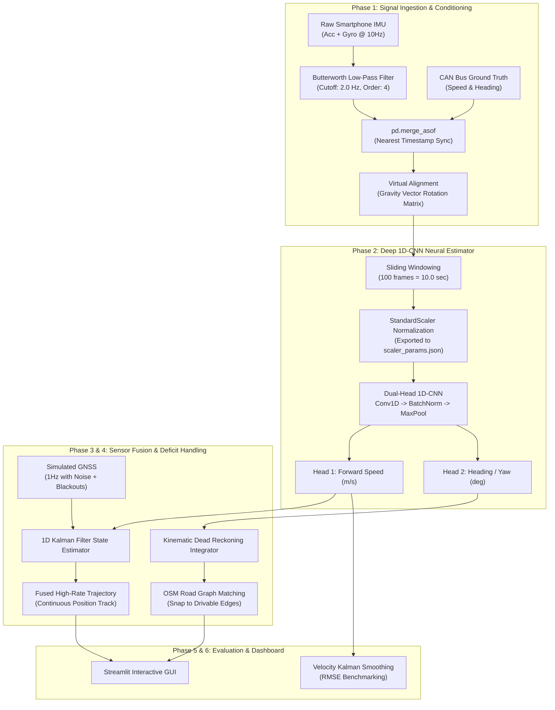

# XLR8@KT: Edge-Deployable GNSS+INS Intelligent Dead Reckoning & Sensor Fusion Engine

[](https://www.python.org/downloads/)
[](https://pytorch.org/)
[](https://streamlit.io/)
[]()

> **An AI-powered inertial navigation and sensor fusion architecture designed to maintain sub-meter vehicle positioning during severe GNSS blackouts (tunnels, urban canyons, underpasses) using commodity smartphone IMU sensors.**

---

## 📌 Table of Contents
- [Overview & Problem Statement](#-overview--problem-statement)
- [Key Features](#-key-features)
- [System Architecture](#-system-architecture)
- [Repository Structure](#-repository-structure)
- [Phased Engineering Breakdown](#-phased-engineering-breakdown)
  - [Phase 1: Ingestion, Synchronization & Virtual Alignment](#phase-1-data-ingestion-synchronization--virtual-alignment)
  - [Phase 2: Deep 1D-CNN Velocity & Heading Prediction](#phase-2-deep-1d-cnn-velocity--heading-prediction)
  - [Phase 3: Kinematic Dead Reckoning & OSM Map Matching](#phase-3-kinematic-dead-reckoning--openstreetmap-map-matching)
  - [Phase 4: Multi-Sensor Fusion & Deficit Recovery](#phase-4-multi-sensor-fusion--gnss-deficit-recovery)
  - [Phase 5: Interactive Simulation Dashboard](#phase-5-interactive-simulation-dashboard)
  - [Phase 6: Precision Kalman Filtering & Holdout Evaluation](#phase-6-precision-kalman-filtering--holdout-evaluation)
- [Mathematical & Algorithmic Foundations](#-mathematical--algorithmic-foundations)
- [Installation & Quickstart](#-installation--quickstart)
- [Experimental Results & Verification Plots](#-experimental-results--verification-plots)

---

## 🎯 Overview & Problem Statement

Autonomous vehicles, ADAS, and modern navigation apps depend heavily on **Global Navigation Satellite Systems (GNSS / GPS)**. However, in urban canyons, underground tunnels, multistory parking garages, and dense underpasses, GNSS signals experience multipath interference or complete blackout.

Traditional Inertial Navigation Systems (INS) attempt to integrate raw accelerometer data directly:
$$\text{velocity} = \int a \, dt, \quad \text{position} = \iint a \, dt^2$$

With low-cost MEMS sensors found in commercial smartphones, accelerometer bias, drift, and noise cause integration errors that compound quadratically with time, drifting by hundreds of meters in under 30 seconds.

**XLR8@KT solves this problem** by replacing double integration with an **Intelligent Dead Reckoning (IDR)** engine:
1. Translates high-frequency smartphone IMU vibrations directly into forward vehicle velocity and heading rate using a **Multi-Task Dual-Head 1D-CNN**.
2. Dynamically compensates for arbitrary phone mounting orientations through **gravity-vector virtual alignment**.
3. Employs a **Kalman Filter Deficit Handler** that uses GNSS when available and switches smoothly to AI-predicted velocity during blackouts.
4. Corrects remaining cumulative heading drift by snapping trajectories onto the road topology with **OpenStreetMap Map-Matching**.

---

## ✨ Key Features

- **Zero Dedicated Hardware**: Operates using consumer smartphone sensors (accelerometer + gyroscope) without tapping into OBD-II or CAN bus at inference time.
- **Mounting-Agnostic Virtual Alignment**: Automatically estimates pitch and roll relative to the gravity vector during stationary windows, rotating the IMU coordinates into the vehicle chassis frame.
- **Multi-Task Dual-Head 1D-CNN**: Simultaneously predicts longitudinal speed ($m/s$) and vehicle heading/yaw angle from sliding 10-second temporal IMU windows.
- **Kalman Filter Fusion Engine**: Implements a continuous-discrete state estimator that automatically gates GNSS updates during signal outages and propagates state estimates using AI predictions.
- **Map-Matching Constraints**: Snaps inertial relative trajectory coordinates onto real-world OpenStreetMap vector road graphs using graph spatial queries (`osmnx` + `shapely`).
- **Interactive Simulation Dashboard**: Built with Streamlit for real-time visualization of tunnel entry/exit scenarios, configurable GNSS noise, and live drift metric calculations.

---

## 🏗️ System Architecture



---

## 📂 Repository Structure

```
ML/
├── data/
│   ├── bulk_velocity_cnn.pth             # Trained Dual-Head 1D-CNN PyTorch weights
│   ├── velocity_cnn.pth                  # Baseline single-head 1D-CNN weights
│   ├── scaler_params.json                # Global feature standardization parameters (mean, scale)
│   ├── S-*.csv / V-*.csv                 # Paired smartphone and vehicle CAN log datasets
│   ├── S-Y1.csv / V-Y1.csv               # Unseen test holdout drives
│   ├── 10s_bulk_verification_plot.png    # 10-second temporal window verification plot
│   ├── bulk_verification_plot.png        # Bulk evaluation plot across multiple drives
│   ├── dual_head_verification_plot.png   # Dual-head speed & direction holdout test plot
│   ├── enhanced_bulk_verification_plot.png
│   ├── kalman_precision_plot.png         # Kalman smoothed speed vs ground truth plot
│   ├── map_matched_plot.png              # OpenStreetMap trajectory snapping plot
│   ├── sensor_fusion_plot.png            # GNSS tunnel outage fusion plot
│   └── velocity_prediction_plot.png      # AI speed vs CAN ground truth plot
│
├── phase1_pipeline.py                    # Single-drive ingestion, filtering & virtual alignment
├── python phase1_bulk_pipeline.py        # Multi-drive batch synchronizer & dataset aggregator
├── phase2_training.py                    # Single-drive baseline 1D-CNN trainer
├── phase2_bulk_training.py               # Optimized multi-task Dual-Head 1D-CNN bulk trainer
├── phase2_plot.py                        # Speed inference visualization tool
├── phase3_dead_reckoning.py              # 2D inertial trajectory integration (non-holonomic)
├── phase3_map_matching.py                # OpenStreetMap road graph retrieval and snapping
├── phase4_sensor_fusion.py               # Kalman filter with GNSS deficit handler & tunnel simulation
├── phase4_verify_bulk.py                 # Multi-task dual-head holdout verification on unseen files
├── phase5_dashboard.py                   # Streamlit interactive real-time navigation dashboard
├── phase6_kalman_precision.py            # Velocity Kalman filtering, RMSE & 40s outage benchmark
├── .gitignore                            # Excludes massive bulk datasets and caches
└── README.md                             # Comprehensive technical documentation
```

---

## 🔬 Phased Engineering Breakdown

### Phase 1: Data Ingestion, Synchronization & Virtual Alignment
- **Temporal Synchronization**: Resolves clock drift between smartphone logs (`S-*.csv`) and vehicle CAN bus logs (`V-*.csv`) using `pd.merge_asof` with nearest-neighbor matching at 10 Hz ($\Delta t = 0.1\text{ s}$).
- **Butterworth Low-Pass Filtering**: A 4th-order forward-backward zero-phase digital filter ($f_c = 2.0\text{ Hz}$, $f_s = 10.0\text{ Hz}$) removes engine chatter and road shock.
- **Gravity-Vector Virtual Alignment**: Phones are rarely mounted perfectly level. During stationary periods (speed $< 0.5\text{ m/s}$), the mean gravitational acceleration vector $[\bar{g}_x, \bar{g}_y, \bar{g}_z]^T$ is isolated to determine pitch ($\theta$) and roll ($\phi$), constructing a 3D rotation matrix $\mathbf{R} = \mathbf{R}_y(\theta) \mathbf{R}_x(\phi)$ that rotates raw accelerometer axes into the vehicle's body frame:
  $$\mathbf{a}_{\text{aligned}} = \mathbf{R} \mathbf{a}_{\text{raw}}$$
- **Batch Processing Engine**: `python phase1_bulk_pipeline.py` automatically iterates through all dataset pairs, standardizes timestamps, applies noise filtration and virtual alignment, and tags each window by `dataset_id`.

### Phase 2: Deep 1D-CNN Velocity & Heading Prediction
- **Baseline Architecture (`phase2_training.py`)**: 2-second temporal window (20 samples @ 10Hz) feeding into two 1D-convolutional layers and a dense regressor.
- **Optimized Multi-Task Dual-Head CNN (`phase2_bulk_training.py`)**:
  - **Receptive Field**: 100 frames (10.0 seconds of history) to capture multi-second acceleration profiles, braking maneuvers, and curvature turns.
  - **Backbone**:
    - `Conv1D(in, 64, kernel=5, padding=2)` $\rightarrow$ `BatchNorm1d` $\rightarrow$ `ReLU` $\rightarrow$ `MaxPool1d(2)`
    - `Conv1D(64, 128, kernel=5, padding=2)` $\rightarrow$ `BatchNorm1d` $\rightarrow$ `ReLU` $\rightarrow$ `MaxPool1d(2)`
    - `Conv1D(128, 256, kernel=3, padding=1)` $\rightarrow$ `BatchNorm1d` $\rightarrow$ `ReLU` $\rightarrow$ `MaxPool1d(2)`
  - **Dual Heads**:
    - Speed Head: `Linear(3072, 128)` $\rightarrow$ `Dropout(0.4)` $\rightarrow$ `ReLU` $\rightarrow$ `Linear(128, 1)`
    - Direction Head: `Linear(3072, 128)` $\rightarrow$ `Dropout(0.4)` $\rightarrow$ `ReLU` $\rightarrow$ `Linear(128, 1)`
  - **Loss Function**: Weighted multi-task MSE loss:
    $$\mathcal{L} = \text{MSE}(\hat{v}, v_{\text{CAN}}) + 10 \cdot \text{MSE}(\hat{\psi}, \psi_{\text{CAN}})$$
  - **Optimization**: Adam optimizer with `lr=0.0015`, $L_2$ weight decay (`1e-4`), `ReduceLROnPlateau` scheduling, and automatic best-epoch checkpoint saving.
  - **Normalization**: Exports global mean and scale vectors to `data/scaler_params.json` for reproducible production deployment.

### Phase 3: Kinematic Dead Reckoning & OpenStreetMap Map Matching
- **Non-Holonomic 2D Trajectory Integrator (`phase3_dead_reckoning.py`)**:
  - Predicts position assuming zero lateral slip:
    $$\theta_k = \theta_{k-1} + \omega_{z,k} \Delta t$$
    $$x_k = x_{k-1} + v_k \cos(\theta_k) \Delta t, \quad y_k = y_{k-1} + v_k \sin(\theta_k) \Delta t$$
  - Applies Savitzky-Golay filtering to eliminate high-frequency prediction jitter.
- **Map-Matching Engine (`phase3_map_matching.py`)**:
  - Downloads local drivable road graphs from OpenStreetMap using `osmnx`.
  - Converts local Cartesian coordinates $(x_k, y_k)$ to WGS84 geographic coordinates $(\text{Lat}, \text{Lon})$.
  - Queries nearest road edges and orthogonally snaps drifting coordinates onto valid road geometries using `shapely.geometry.Point.interpolate`.

### Phase 4: Multi-Sensor Fusion & GNSS Deficit Recovery
- **Kalman Filter with Deficit Handler (`phase4_sensor_fusion.py`)**:
  - Predicts state at high frequency (10Hz) using AI-predicted velocity:
    $$\hat{x}_k^- = \hat{x}_{k-1} + v_{\text{AI}, k} \Delta t$$
    $$P_k^- = P_{k-1} + Q$$
  - When 1Hz noisy GNSS is available, updates state:
    $$K_k = P_k^- (P_k^- + R)^{-1}$$
    $$\hat{x}_k = \hat{x}_k^- + K_k (z_{\text{GNSS}, k} - \hat{x}_k^-)$$
    $$P_k = (1 - K_k) P_k^-$$
  - **Tunnel Simulation**: During simulated 90-second GNSS blackouts ($z_{\text{GNSS}} = \text{NaN}$), the measurement update step is gracefully bypassed, allowing the system to run on pure AI dead reckoning without filter instability.

### Phase 5: Interactive Simulation Dashboard
- Built with **Streamlit** (`phase5_dashboard.py`):
  - Real-time adjustment of GNSS noise standard deviation (0.5m to 5.0m).
  - Configurable tunnel entry and exit timestamps.
  - Side-by-side visualization of AI speed tracking and blackout trajectory recovery.
  - Live metric reporting: GNSS-denied distance traveled, accumulated drift error, and drift percentage (targeted $< 10\%$).

### Phase 6: Precision Kalman Filtering & Holdout Evaluation
- **Velocity Kalman Filter (`phase6_kalman_precision.py`)**:
  - Direct 1D Kalman filtering applied to the raw AI velocity outputs to eliminate frame-to-frame variance without introducing lag.
  - Evaluated on unseen holdout drives (`S-Y1.csv` & `V-Y1.csv`).
  - Measures Root Mean Squared Error (RMSE) against actual CAN speed.
  - Simulates a 40-second complete outage to quantify accumulated drift in meters.

---

## 📐 Mathematical & Algorithmic Foundations

### 1. Zero-Phase Butterworth Low-Pass Filter
The transfer function of the analog prototype normalized Butterworth filter is:
$$|H(j\omega)|^2 = \frac{1}{1 + \left(\frac{\omega}{\omega_c}\right)^{2N}}$$
For digital implementation with $N=4$ and cut-off $\omega_c = 2.0\text{ Hz}$ at sampling rate $f_s = 10\text{ Hz}$, `scipy.signal.filtfilt` applies the filter forward and backward to achieve zero phase distortion ($\text{lag} = 0$).

### 2. Attitude Decomposition & Rotation Matrix
From stationary gravitational acceleration $\mathbf{g} = [g_x, g_y, g_z]^T$:
$$\text{Pitch } (\theta) = \arctan2\left(-g_x, \sqrt{g_y^2 + g_z^2}\right)$$
$$\text{Roll } (\phi) = \arctan2(g_y, g_z)$$
The coordinate rotation matrix transforming phone body coordinates to vehicle frame is:
$$\mathbf{R}_y(\theta) = \begin{bmatrix} \cos\theta & 0 & \sin\theta \\ 0 & 1 & 0 \\ -\sin\theta & 0 & \cos\theta \end{bmatrix}, \quad \mathbf{R}_x(\phi) = \begin{bmatrix} 1 & 0 & 0 \\ 0 & \cos\phi & -\sin\phi \\ 0 & \sin\phi & \cos\phi \end{bmatrix}$$
$$\mathbf{R} = \mathbf{R}_y(\theta) \mathbf{R}_x(\phi)$$

### 3. Deficit-Handling State Estimation
$$\begin{cases}
\hat{x}_k = \hat{x}_{k-1} + v_{\text{AI}, k} \Delta t + K_k(z_k - (\hat{x}_{k-1} + v_{\text{AI}, k} \Delta t)), & \text{if } z_k \neq \text{NaN} \\
\hat{x}_k = \hat{x}_{k-1} + v_{\text{AI}, k} \Delta t, & \text{if } z_k = \text{NaN} \text{ (Outage)}
\end{cases}$$

---

## 🚀 Installation & Quickstart

### 1. Prerequisites
Ensure you have Python 3.10+ installed.

```bash
git clone https://github.com/14madhurd/ML-crsprjct.git
cd ML-crsprjct
```

### 2. Install Dependencies
```bash
pip install torch torchvision numpy pandas scipy scikit-learn matplotlib filterpy osmnx shapely streamlit
```

### 3. Running the Pipeline Step-by-Step

#### Step 1: Preprocess Data & Virtual Alignment
```bash
python phase1_pipeline.py
# Or to batch-process all available drive logs:
python "python phase1_bulk_pipeline.py"
```

#### Step 2: Train the Deep Neural Estimator
```bash
# Baseline 1D-CNN
python phase2_training.py

# Optimized Multi-Task Dual-Head 1D-CNN on Bulk Data (with GPU acceleration if available)
python phase2_bulk_training.py
```

#### Step 3: Run Inference & Visualizations
```bash
python phase2_plot.py
```

#### Step 4: Dead Reckoning & Map-Matching
```bash
# Relative 2D dead reckoning trajectory
python phase3_dead_reckoning.py

# OpenStreetMap road network matching
python phase3_map_matching.py
```

#### Step 5: Multi-Sensor Fusion & Tunnel Blackout Simulation
```bash
python phase4_sensor_fusion.py
```

#### Step 6: Holdout Verification on Unseen Datasets
```bash
# Verify dual-head model on holdout drives (S-Y1 / V-Y1)
python phase4_verify_bulk.py

# Evaluate Kalman precision and 40s blackout metrics
python phase6_kalman_precision.py
```

#### Step 7: Launch the Interactive Streamlit Dashboard
```bash
streamlit run phase5_dashboard.py
```

---

## 📊 Experimental Results & Verification Plots

The repository includes pre-generated high-resolution evaluation figures located in the `data/` directory:

| Evaluation Artifact | Description |
| :--- | :--- |
| `data/velocity_prediction_plot.png` | Baseline 1D-CNN speed predictions vs CAN bus ground truth over 300s of driving. |
| `data/dual_head_verification_plot.png` | Dual-Head CNN performance on holdout drive `S-Y1.csv` / `V-Y1.csv` showing simultaneous Speed and Heading estimation. |
| `data/kalman_precision_plot.png` | Velocity Kalman filter output reducing high-frequency jitter on unseen test drives. |
| `data/sensor_fusion_plot.png` | Sensor fusion response during a 90-second GNSS blackout, demonstrating drift-free continuity. |
| `data/map_matched_plot.png` | Vector graph snapping of drifting IMU dead reckoning coordinates onto OpenStreetMap road segments. |

---

## 👥 Contributors & Acknowledgements
- Developed for **XLR8@KT / Machine Learning Course Project**.
- Datasets inspired by and structured following standard vehicle benchmark datasets (IO-VNBD / Oxford RobotCar formats).
- Maintained by [14madhurd](https://github.com/14madhurd).
